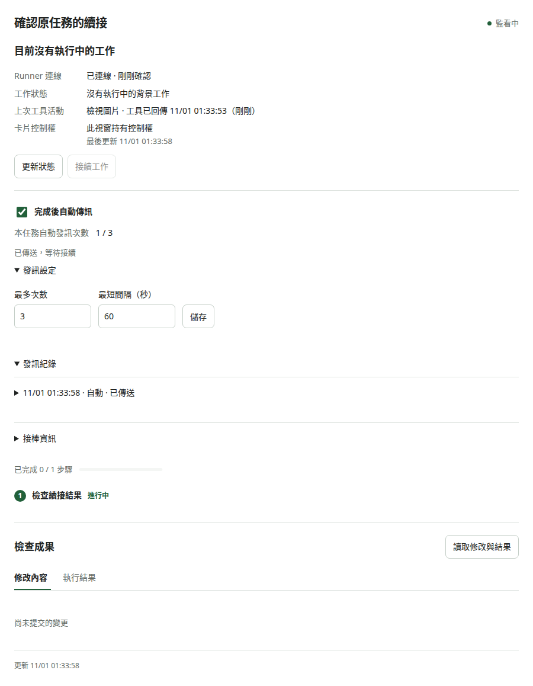

# WebCodex Harness

English | [繁體中文](README.zh-TW.md)

Let an MCP client work with repositories and desktop applications on your machine. A Server manages authentication and tasks; outbound Runners execute tools locally.

## What it does

- Read, search and edit files with hash checks; use Git, commands, tests and interactive terminals.
- Resume saved tasks and monitor running processes.
- Create or register projects under explicitly allowed parent directories, even with no existing task.
- Load project skills and plugins with persistent MCP connections.
- Optionally capture and control the desktop, including Unicode text input.
- Add browser navigation, forms, tabs and page data extraction with the optional Playwright MCP plugin.

## Task card in ChatGPT

WebCodex provides an interactive task card through MCP Apps. Open it with `task_present(task_id)` in a compatible client such as ChatGPT.



- Follow task status, work steps and connection state.
- Inspect the project's current uncommitted changes and open individual file diffs.
- View this task's recent command results, exit codes and output.
- Pause or enable automatic continuation. When work registered with `task_wait` produces a result, the foreground card can request that the conversation continue; already running work continues while automatic continuation is paused.

See [Task cards and continuation](docs/CHATGPT.md#任務卡片與跨回合續接) for client requirements and the continuation workflow.

### ChatGPT 平台已知限制：再次詢問工具授權

長時間對話可能再次出現「允許一次／一律允許」的工具確認。已觀察到外掛設定為 `Allow all actions`、WebCodex 服務持續在線時仍發生此情況，列為 ChatGPT 平台端的已知限制。WebCodex 沒有數小時後撤銷工具授權的設定。

遇到提示時，在原對話確認工具操作；已送到 Runner 的工作仍可繼續執行。服務正常時，無需為此重啟 Server、bridge 或 Runner。官方說明對話內記住的允許可在重新整理後再次詢問；每個外掛的允許設定仍重問的觸發原因尚未確認，也未查到固定到期時間。詳見[平台授權限制與排查](docs/CHATGPT.md#chatgpt-平台已知限制再次詢問工具授權)。

## Accounts and computers

Names such as `WebCodex ll1` label a ChatGPT connection. The task's project and Runner determine which computer executes its tools.

| Situation | Setup |
| --- | --- |
| Same ChatGPT account and workspace, ChatGPT web on another computer | Use the existing installed plugin |
| Another ChatGPT account | Install or create a connection with access to the same Server/tunnel; share the existing Server and Runner |
| Execute tools on Windows | Register a Windows Runner and its project with the existing Server, authorize the client to use it and keep the same plugin |
| Run a separate Server on another computer | Add a connection to that Server's endpoint; use a different name to distinguish it |

When switching accounts, check the tunnel's workspace associations and use permissions. To resume saved tasks, retain the same WebCodex client identity and use `task_list`/`task_get`. See [Account and computer setup](docs/CHATGPT.md#換帳號與換電腦).

## Quick start

Requires Python 3.11+, [uv](https://docs.astral.sh/uv/getting-started/installation/), Git and ripgrep (`rg`). Run from this source checkout:

```sh
uv sync --locked
uv run webcodex init --project /absolute/path/to/your/repo
```

On Windows, replace the project path with a path such as `'C:\src\my-repo'`. Configuration stays outside the project in `~/.config/webcodex-harness/` or `%LOCALAPPDATA%\webcodex-harness\`; existing configuration is preserved.

To start with no existing project, use `init --project-root /absolute/path/to/projects` with an existing parent directory. See [Project creation](docs/PROJECTS.md) for setup and enabling an existing installation.

Start each command in its own terminal:

```sh
uv run webcodex serve
uv run webcodex runner
```

Connect to `http://127.0.0.1:8765/mcp` using the Bearer token in the generated `client.json`, or use `uv run webcodex bridge` for stdio. See [Connections](docs/CHATGPT.md) for client and ChatGPT setup, and [Operations](docs/OPERATIONS.md) to create your first task.

Desktop tools require the optional `computer` dependencies and explicit permissions. Follow [Computer use](docs/COMPUTER_USE.md) for installation, enabling an existing setup and the screenshot → input → verification workflow.

**Computer use controls the desktop on the Runner's machine.** The Server relays requests and results; the task's Runner determines the target computer, independently of the computer displaying ChatGPT. To control Windows, start a native Runner in that Windows interactive desktop and select a project registered by it.

Windows can run both Server and Runner independently. See the [Windows setup guide](docs/WINDOWS_RUNNER.md) for PowerShell installation, startup and multi-monitor tests. Windows desktop tools list monitors and capture a selected monitor, including displays to the left of or above the primary display.

For an installation managed by the Windows keepalive task, run [`Start-WebCodex.ps1`](examples/windows/Start-WebCodex.ps1) to start the services using the saved configuration and key.

子代理由 ChatGPT／MCP 用戶端原生協調；WebCodex 提供檔案、命令與桌面工具。[子代理分工](docs/SUBAGENTS.md)說明工具使用與舊版遷移。

Browser tools use a separately installed Node.js/Chrome provider, with isolated sessions per task. Follow [Browser use](docs/BROWSER_USE.md) for setup and optional login persistence.

## Permissions and limits

- 已授權的專案建立、命令、Git、擴充與桌面操作會直接執行，不需逐筆核准或信任設定。設定與舊版升級方式見[授權與執行](docs/EXECUTION.md)。
- Shells, plugins and desktop input use the Runner account's permissions, with **no OS sandbox**. Desktop access covers the shared screen, including content outside the project. Keep configuration and state private; screenshots and typed text have no automatic expiry.
- Ubuntu X11 control has been tested on a virtual desktop. Windows capture and input have been tested on three physical monitors, including a left-side display and mixed 150%/100% scaling. Interactive macOS validation is pending. Wayland/WSLg and locked desktops are unsupported.

## Guides

Detailed guides are in Traditional Chinese:

- Usage: [Operations](docs/OPERATIONS.md) · [Computer use](docs/COMPUTER_USE.md) · [Browser use](docs/BROWSER_USE.md) · [Connections](docs/CHATGPT.md) · [Extensions](docs/EXTENSIONS.md)
- Project: [Architecture](docs/ARCHITECTURE.md) · [Platform validation](docs/PLATFORMS.md) · [Feature roadmap](docs/ROADMAP.md)
- Development: [Contributing and tests](CONTRIBUTING.md) · [Security reporting](.github/SECURITY.md) · [Release readiness](docs/RELEASING.md)

An independent Python implementation inspired by [yyjeqhc/webcodex](https://github.com/yyjeqhc/webcodex). Your MCP client provides the reasoning and conversation.

## Copyright

Third-party dependencies retain their respective licenses.

```less
Copyright © 2026 Hao-Ping Lin (@susuky). All rights reserved.
```
