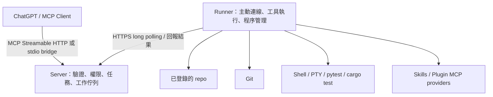

# WebCodex Harness

讓 ChatGPT 或其他 MCP 用戶端，透過你自己的 Runner 讀取與修改 repo、操作 Git、執行測試，並延續同一個 coding task。

這是獨立實作，參考 [yyjeqhc/webcodex](https://github.com/yyjeqhc/webcodex) 的 Server／Runner 分工；沒有複製它的程式或使用它的套件。推理與對話由 MCP 用戶端負責，本專案負責工具執行、權限與可恢復的工作紀錄。



## 快速啟動

支援 Ubuntu、Windows 原生與 Windows WSL2，需要 Python 3.11+、Git；全文搜尋使用 `rg`。**Ubuntu 24.04、Windows 11 原生及 WSL2 Ubuntu 22.04 均已實機測試通過。** Windows 原生 19 項通過；Ubuntu／WSL2 各 15 項通過，略過 4 項 Windows 專用測試。完整步驟見 [操作教學](docs/OPERATIONS.md) 與 [平台驗證紀錄](docs/PLATFORMS.md)。

以下為 Ubuntu／WSL2 Bash 命令；Windows PowerShell 的初始化路徑與 JSON 傳參方式請使用操作教學。

```bash
uv sync --locked
uv run webcodex init --project /absolute/path/to/your/repo
```

Ubuntu／WSL2 設定預設建立在 `~/.config/webcodex-harness/`，Windows 原生則在 `%LOCALAPPDATA%\webcodex-harness\`；必須位於所登錄的 repo 外。初始化不覆寫既有設定，不印出憑證，並產生互不相同的用戶端、Runner 和操作員憑證。

分別在兩個終端執行：

```bash
uv run webcodex serve
```

```bash
uv run webcodex runner
```

預設 MCP 位置為 `http://127.0.0.1:8765/mcp`。一般 MCP 用戶端可從 `client.json` 取得 Bearer 憑證；也能直接啟動下方的 stdio bridge，由它在本機讀取設定並驗證 HTTP 連線：

```bash
uv run webcodex bridge
```

**ChatGPT 接入**請依 [連線指南](docs/CHATGPT.md) 設定 Secure MCP Tunnel，或符合用戶端驗證要求的 HTTPS 入口。單純啟動本機服務不會自動替 ChatGPT 帳號建立連線。

## 執行第一個任務

```bash
uv run webcodex call projects_list
uv run webcodex call task_create --arguments '{"project":"local/project","title":"檢查專案並執行測試"}'
```

後續使用回傳的 `id` 作為 `task_id`；下方的 `TASK_ID` 需換成該 ID：

```bash
uv run webcodex call workspace_info --arguments '{"task_id":"TASK_ID"}'
uv run webcodex call exec_command --arguments '{"task_id":"TASK_ID","argv":["python3","-m","pytest","-q"],"request_id":"pytest-1"}'
uv run webcodex call exec_command --arguments '{"task_id":"TASK_ID","argv":["cargo","test"],"request_id":"cargo-1"}'
```

預設命令執行、Git 寫入與擴充安裝需要操作員核准；以 `webcodex approvals` 檢視完整操作，再執行 `webcodex approve JOB_ID` 或 `webcodex deny JOB_ID`。MCP 用戶端沒有自行核准的工具。

若你已決定讓這個用戶端完整控制 Runner 的作業系統帳號，可在初始化時加 `--trusted`。這會保留驗證與專案路徑檢查，但不再將命令和安裝工作排入人工核准。

## 工作與程序的差別

- `task_id`：專案工作、摘要、計畫、問答與事件紀錄的持久識別碼；可以跨 MCP 連線和 Server 重啟使用。
- `job_id`：一次工具呼叫。`queued`、`running` 或 `pending_approval` 時使用 `job_get` 繼續觀察；不要重新發起操作。
- `process_id`：已啟動的命令或 PTY。使用 `read_process` 的位元組游標讀取輸出、`write_stdin` 傳入輸入、`cancel_process` 停止整個程序群組。

同一次操作重試時，沿用相同 `request_id` 和參數；不同參數重用相同 ID 會被拒絕。未提供 `request_id` 的新呼叫會建立新工作。`exec_command` 工作成功只表示命令已啟動並取得控制代碼，**測試是否成功仍要看程序的 `exit_code`**。

Server 重啟或網路斷線不會重跑命令。Runner 本身重啟後保留輸出與紀錄，舊程序標示為 `interrupted`，不宣稱能接管先前的作業系統程序。已領取但無法確認結果的工作標示為 `unknown`；先核對實際狀態，再決定是否發起新操作。

## 現有工具

目前提供 45 個 MCP 工具；`webcodex tools` 可查看完整參數 schema，`tool_search` 可依用途探索。

| 用途 | 工具 |
| --- | --- |
| 專案與規則 | `projects_list`、`workspace_info`、`read_instructions` |
| 檔案 | `list_files`、`search_files`、`read_file`、`write_file`、`edit_file`、`delete_file`、`apply_patch` |
| Git | `git_status`、`git_diff`、`git_log`、`git_stage`、`git_commit` |
| 命令與終端 | `exec_command`、`read_process`、`write_stdin`、`cancel_process`、`resize_terminal`、`list_processes` |
| 任務與延續 | `task_create`、`task_list`、`task_get`、`task_update`、`task_events`、`job_get`、`job_cancel`、`request_user_input` |
| 圖片與網頁 | `view_image`、`fetch_url` |
| Skills | `skills_list`、`skill_read`、`skill_run` |
| 安裝與探索 | `extension_install`、`extension_remove`、`plugins_list`、`tool_search` |
| Plugin MCP | `plugin_tools`、`plugin_call`、`plugin_resources`、`plugin_read_resource`、`plugin_prompts`、`plugin_get_prompt`、`plugin_disconnect` |

檔案覆寫、編輯與刪除需要 `read_file` 回傳的整份檔案 SHA-256，避免覆蓋過期版本。`apply_patch` 接受標準 unified Git diff，先檢查檔案雜湊、路徑及 `git apply --check`，再套用；不接受 Codex 的 `*** Begin Patch` 語法、二進位 patch、rename、copy 或 symlink patch。

## Plugins 與 Skills

可從 repo 內的本機目錄或固定 commit 的 HTTPS Git repository 安裝。支援 `SKILL.md`、`.codex-plugin/plugin.json`、`.claude-plugin/plugin.json` 及 MCP 設定；安裝範圍是目前專案，不會修改這台 Codex app 的全域外掛設定。

如果登錄的專案就是本 repository，可安裝附帶的實際範例：

```bash
uv run webcodex call extension_install --arguments '{"task_id":"TASK_ID","kind":"plugin","source":"examples/plugins/project-tools"}'
uv run webcodex call plugin_tools --arguments '{"task_id":"TASK_ID","plugin":"project-tools","server":"project"}'
uv run webcodex call plugin_call --arguments '{"task_id":"TASK_ID","plugin":"project-tools","server":"project","tool_name":"project_stats","arguments":{}}'
```

依各次呼叫回傳的工作狀態完成核准與等待後，再進行下一步。詳見 [擴充套件指南](docs/EXTENSIONS.md)。

## 權限與執行範圍

Server 控制用戶端能操作哪些專案及工具類別；Runner 再次驗證工具權限與專案綁定。檔案工具拒絕 `..`、絕對路徑、symlink、hardlink 與 `.git`／`.webcodex` 私有目錄。Git 的 working tree 必須與登錄的專案根目錄一致。

**Shell 與 plugin 程式以 Runner 的作業系統帳號執行，沒有 OS sandbox。** 指定 `cwd` 不會限制 shell 對其他檔案或網路的存取；授予 `execute` 也不能再靠 `git_write` 限制它執行 Git。需要隔離不受信任的程式時，將 Runner 放在獨立帳號或容器，僅提供必要的專案和憑證。設定與執行紀錄應放在 repo 外。

預設限制包括每位用戶端 100 個未完成工作、每個 Runner 16 個同時執行的程序、每程序 8 MiB 輸出和最長一小時；輸出到達上限後仍會持續排空管線並標示截斷。已完成紀錄保留於本機 SQLite，目前沒有自動清理機制。

## 能力邊界

本專案提供 coding harness 的工具及工作延續層。瀏覽器操作、LSP、外部服務、影像生成或另一個 coding agent，可透過你安裝並配置的 MCP provider 擴充；不內建它們的服務、授權或付費額度。ChatGPT 關閉後，已啟動的程序可以繼續，Server 不會自行產生新的模型推理。

目前沒有 GUI、QUIC／WebSocket Runner 傳輸、內建 OAuth authorization server、全域外掛市集、hooks 執行器或 macOS Runner 支援。使用 long polling、標準 MCP SDK 與 stdio bridge；Windows 原生使用 PowerShell、ConPTY 與 Job Objects，WSL2 使用 Linux Runner。

## 驗證與開發

```bash
uv run pytest -q
uv run ruff check src tests examples
uv run ruff format --check src tests examples
uv build
```

測試透過真正的 TCP MCP 連線及 Runner 驗證 repo 修正、pytest、Git diff、命令去重、PTY、原生圖片回傳、擴充安裝、MCP provider 連續呼叫、憑證隔離、操作員核准與重新連線。若 PATH 中有 Cargo，也會測試真實 `cargo test --offline`；否則只跳過該項工具鏈測試。

也可用 `WEBCODEX_TEST_RUST_BIN=/absolute/path/to/rust/bin` 指定測試用工具鏈。HTTPS Git 安裝測試需另外設定 `WEBCODEX_TEST_SKILL_COMMIT`，值為 `anthropics/skills` 的固定 commit；未設定時不會在測試中下載外部 repo。

更詳細的執行契約與檔案分工見 [架構文件](docs/ARCHITECTURE.md)。
