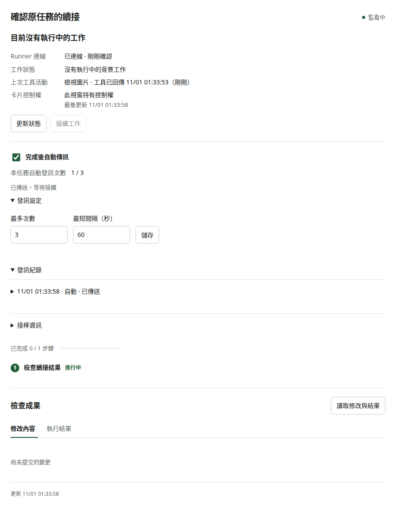

# WebCodex Harness

[English](README.md) | 繁體中文

讓 MCP 用戶端操作你電腦上的 repo 與桌面應用程式。Server 管理驗證與任務；Runner 主動連線，在本機執行工具。

## 功能

- 讀取、搜尋及以雜湊檢查修改檔案；使用 Git、命令、測試與互動終端。
- 延續已儲存的任務，監看執行中的程序。
- 在明確允許的父目錄建立或登記專案，不需要已有任務。
- 載入專案 skills 與 plugins，保留 MCP 連線狀態。
- 選擇啟用桌面截圖與控制，包含 Unicode 文字輸入。
- 透過選用的 Playwright MCP plugin 操作網頁、填表、切換分頁及擷取資料。

## ChatGPT 任務卡片

WebCodex 透過 MCP Apps 提供互動式任務卡片。在 ChatGPT 等支援的用戶端呼叫 `task_present(task_id)` 即可開啟。



操作示範（測試資料）。

- 查看任務狀態、工作步驟與連線狀態。
- 檢視專案目前尚未提交的變更，點選檔案查看差異。
- 查看此任務最近命令的執行結果、結束碼與輸出。
- 長命令在原回合使用 `job_get`／`read_process` 取得結果後繼續。
- 使用「接續工作」手動接回，或明確開啟「完成後自動傳訊」，設定本任務次數與間隔；重連與接手後回到關閉。
- 新對話按「在此接手」，讀取修改檔案、驗證、未讀輸出與下一步。

用戶端需求與續接流程見 [任務卡片與跨回合續接](docs/CHATGPT.md#任務卡片與跨回合續接)。

### ChatGPT 平台已知限制：再次詢問工具授權

長時間對話可能再次出現「允許一次／一律允許」的工具確認。已觀察到外掛設定為 `Allow all actions`、WebCodex 服務持續在線時仍發生此情況，列為 ChatGPT 平台端的已知限制。WebCodex 沒有數小時後撤銷工具授權的設定。

遇到提示時，在原對話確認工具操作；已送到 Runner 的工作仍可繼續執行。服務正常時，無需為此重啟 Server、bridge 或 Runner。官方說明對話內記住的允許可在重新整理後再次詢問；每個外掛的允許設定仍重問的觸發原因尚未確認，也未查到固定到期時間。詳見[平台授權限制與排查](docs/CHATGPT.md#chatgpt-平台已知限制再次詢問工具授權)。

## 換帳號與換電腦

`WebCodex ll1` 等名稱是 ChatGPT 連線的標籤。任務所選的專案與 Runner 決定工具實際在哪台電腦執行。

| 情境 | 設定方式 |
| --- | --- |
| 同一 ChatGPT 帳號與工作區，換電腦開啟 ChatGPT 網頁 | 選用已安裝的原外掛 |
| 換 ChatGPT 帳號 | 在新帳號安裝或建立連線，確認可使用原 Server／tunnel；Server 與 Runner 可共用 |
| 希望工具在 Windows 執行 | 將 Windows Runner 與專案登記到原 Server，授權用戶端使用該專案，可沿用同一外掛 |
| 另一台電腦獨立架設另一個 Server | 新增指向該 Server 入口的連線，可用不同名稱區分 |

換帳號時需確認 tunnel 的工作區關聯與使用權限。接續原任務還需保留相同的 WebCodex 用戶端身分，再用 `task_list`／`task_get` 讀取紀錄。詳見 [換帳號與換電腦的連線設定](docs/CHATGPT.md#換帳號與換電腦)。

## 快速啟動

需要 Python 3.11+、[uv](https://docs.astral.sh/uv/getting-started/installation/)、Git 與 ripgrep（`rg`）。在本專案原始碼目錄執行：

```sh
uv sync --locked
uv run webcodex init --project /absolute/path/to/your/repo
```

Windows 請改用 `'C:\src\my-repo'` 等專案路徑。設定放在專案外的 `~/.config/webcodex-harness/` 或 `%LOCALAPPDATA%\webcodex-harness\`，保留既有設定。

還沒有專案時，改用 `init --project-root /absolute/path/to/projects` 指定既有父目錄。既有安裝可用 `uv run webcodex allow-root /absolute/path/to/projects` 登記父目錄，保留原憑證並自動備份設定。完成後重啟 Server 與 Runner，詳見 [建立專案](docs/PROJECTS.md)。

在不同終端機分別執行：

```sh
uv run webcodex serve
uv run webcodex runner
```

使用產生的 `client.json` 內 Bearer 憑證連線至 `http://127.0.0.1:8765/mcp`，或以 `uv run webcodex bridge` 使用 stdio。用戶端與 ChatGPT 設定見 [連線指南](docs/CHATGPT.md)，建立第一個任務見 [操作教學](docs/OPERATIONS.md)。

桌面工具需安裝選用的 `computer` 依賴並明確授予權限。[桌面操作指南](docs/COMPUTER_USE.md) 涵蓋安裝、既有設定啟用，以及「截圖 → 輸入 → 確認結果」流程。

**Computer use 操作 Runner 所在電腦的桌面。** Server 負責轉送請求與結果；操作目標由任務所屬的 Runner 決定，與開啟 ChatGPT 網頁的電腦無關。要控制 Windows，就在該 Windows 的互動桌面啟動原生 Runner，並選用它登記的專案。

Windows 可獨立執行 Server 與 Runner。可貼上的 PowerShell 安裝、啟動與多螢幕測試指令見 [Windows 安裝指南](docs/WINDOWS_RUNNER.md)。Windows 桌面工具可列出螢幕並擷取指定螢幕，支援位於主螢幕左方或上方的副螢幕。

已安裝 Windows 常駐排程時，可執行 [`Start-WebCodex.ps1`](examples/windows/Start-WebCodex.ps1)，沿用現有設定與金鑰啟動服務。

子代理由 ChatGPT／MCP 用戶端原生協調；WebCodex 提供檔案、命令與桌面工具。所有對話都禁止經由 WebCodex 啟動 Codex／Work worker，沒有可重新開啟的設定。[子代理分工](docs/SUBAGENTS.md)說明工具使用、啟動拒絕規則與舊版遷移。

瀏覽器工具使用另外安裝的 Node.js／Chrome provider，各任務使用獨立連線與瀏覽器狀態。設定與選用的登入保存見 [瀏覽器操作指南](docs/BROWSER_USE.md)。

## 完整成功案例

Server 與 Runner 啟動後，在同一安裝環境執行：

```text
uv run webcodex call projects_list
uv run python examples/same_turn_demo.py --project local/project
```

示範會建立任務、執行一次四秒命令，持續讀取原程序，取得結果後保存完成狀態。輸出包含 task ID、`demo started`、`demo finished` 與 `exit_code: 0`。在 `/manage` 可直接看到同一任務；[操作展示](docs/DEMO.md)包含 ChatGPT 使用方式與跨對話接手。

## 管理與維護

開啟 `http://127.0.0.1:8765/manage`，使用 `client.json` 的 Token 登入。Runner、任務、程序、最後輸出與錯誤集中顯示；執行中的程序沿用 `read_process` 更新。

```text
uv run webcodex doctor --share --output diagnostics.json
uv run webcodex backup
uv run webcodex update-check
uv run webcodex retention --days 30 --max-mib 1024 --save-policy
```

診斷會遮蔽私人路徑與憑證；`update-check` 在 Runner 重啟前列出仍執行的 process／delivery ID。保留期限預設只預覽，加入 `--apply` 才清理已結束的輸出與附件。[安裝與維護](docs/INSTALLATION.md)把 Windows／Ubuntu 首次連線、更新與回復串成完整流程。

桌面操作新增 Windows UI Automation 與 Ubuntu AT-SPI，可按視窗、控制項名稱、角色或 automation ID 尋找按鈕與輸入框。每次動作重新解析控制項，視窗移動或縮放後仍沿用語意選擇器。設定與原生驗收指令見[語意桌面控制](docs/SEMANTIC_DESKTOP.md)。

## 權限與限制

- 已授權的專案建立、命令、Git、擴充與桌面操作會直接執行，不需逐筆核准或信任設定。設定與舊版升級方式見[授權與執行](docs/EXECUTION.md)。
- Shell、plugin 與桌面輸入使用 Runner 帳號權限，**沒有 OS sandbox**。桌面存取涵蓋共用畫面，可能包含專案外內容。設定與狀態應保持私有；`webcodex retention` 可設定輸出與附件的容量、天數，先預覽再清理。
- Ubuntu X11 控制已在虛擬桌面測試；Windows 已在三個實體螢幕驗證截圖與輸入，包含左側副螢幕和 150%／100% 混合縮放。macOS 互動桌面仍待實機驗收。Wayland／WSLg 與鎖定桌面尚不支援。

## 文件

詳細指南使用繁體中文：

- 使用：[安裝與管理](docs/INSTALLATION.md) · [操作展示](docs/DEMO.md) · [操作教學](docs/OPERATIONS.md) · [桌面操作](docs/COMPUTER_USE.md) · [瀏覽器操作](docs/BROWSER_USE.md) · [連線設定](docs/CHATGPT.md) · [擴充套件](docs/EXTENSIONS.md)
- 專案：[架構](docs/ARCHITECTURE.md) · [平台驗證](docs/PLATFORMS.md) · [功能規劃](docs/ROADMAP.md)
- 開發：[參與開發與測試](CONTRIBUTING.md) · [安全回報](.github/SECURITY.md) · [發布準備](docs/RELEASING.md)

這是參考 [yyjeqhc/webcodex](https://github.com/yyjeqhc/webcodex) 的獨立 Python 實作。推理與對話由 MCP 用戶端負責。

## 版權

第三方依賴保留各自的授權條款。

```less
Copyright © 2026 Hao-Ping Lin (@susuky). All rights reserved.
```
