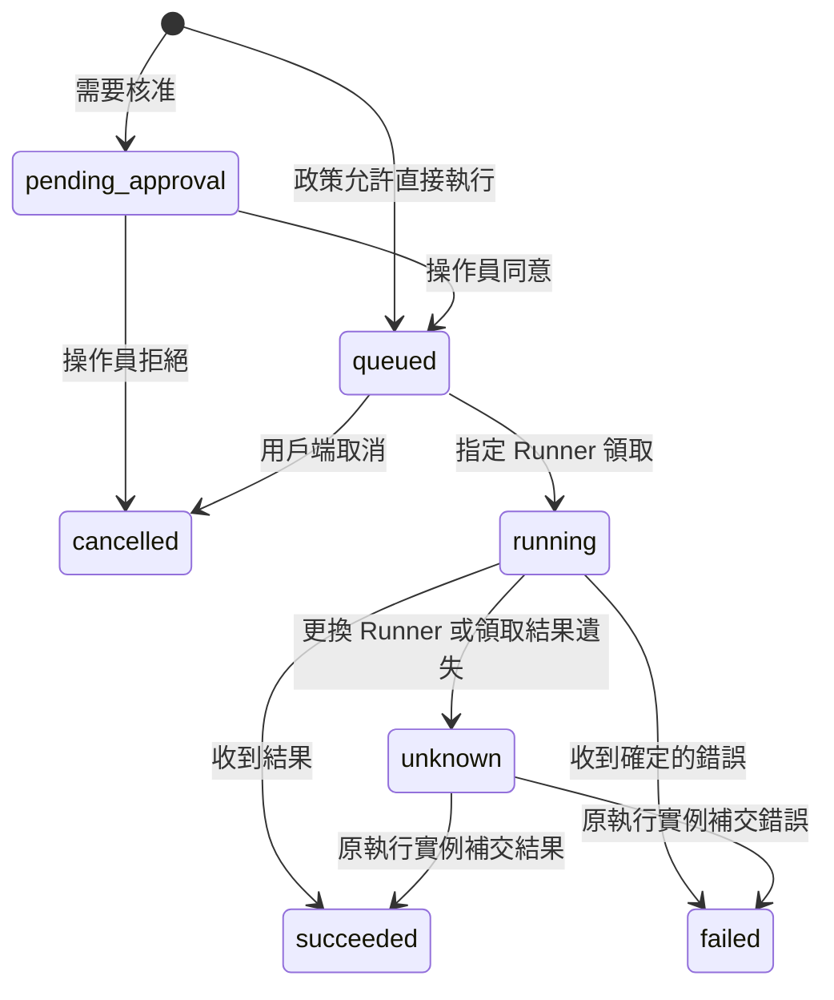

# 架構與執行契約

## 分工

Server 不直接讀取專案目錄。它提供 MCP Streamable HTTP 與相同工具的 REST adapter，驗證用戶端身分，保存工作，並將操作交給擁有專案的 Runner。Runner 只主動連線，不需要對外開放入站服務。

Server 與 Runner 目前採 HTTPS long polling；同機開發允許 loopback HTTP。結果完成時立即另送 HTTP 回報，不必等待下一次 polling。MCP 使用官方 Python SDK，並採 stateless transport；業務任務由 SQLite 保存，與 MCP transport session 明確分開。[MCP Python SDK](https://github.com/modelcontextprotocol/python-sdk)

這個分工參考 [WebCodex 架構](https://github.com/yyjeqhc/webcodex/blob/main/docs/ARCHITECTURE.md)。檔案、命令、工具探索與外部 MCP 是 coding harness 的共同組成；本專案將推理循環留在 ChatGPT／MCP 用戶端。[Claude Code agent loop](https://code.claude.com/docs/en/agent-sdk/agent-loop)

## 身分與專案

- 每個用戶端有自己的 token、專案清單與 `permissions`。
- 每台 Runner 使用獨立 token，不能拿它呼叫 MCP 或操作員 API。
- 操作員 token 只用於核准與回答問題；MCP 工具清單不暴露這些操作。
- `runner_id/project_id` 指向已登錄專案。綁定包含 canonical path、檔案系統裝置與 inode 的雜湊；更換根目錄需要建立新任務。
- 任務與工作紀錄依用戶端身分隔離。共同獲准的專案仍是共享的真實檔案系統，並非多租戶 OS 隔離。

`read`、`write`、`execute`、`git_write`、`extensions` 決定可用工具類別。`approval_required` 決定哪些 Runner 操作先進入核准佇列。即使 Server 允許，Runner 的 `permissions` 仍可進一步拒絕。

權限設定在啟動時載入。修改設定並重新啟動 Server 後，尚未交付的工作會在送給 Runner 前重查權限；撤銷的工作不執行，新增加的核准要求也會生效。已交付或執行中的作業不會因設定變更自動回溯取消。

## 工作狀態

SQLite 的 `UNIQUE(owner, task_id, request_id)` 讓相同請求取得原工作。執行前先在 Runner journal 落盤，再啟動工具；完成結果在收到 Server acknowledgement 前保留。回報重試不能覆寫已接受的終態。

不承諾分散式系統中的 exactly-once。領取回覆遺失、程序崩潰或外部工具斷線可能讓結果不確定；系統標示 `unknown`，不把修改操作自動放回佇列。重連時 Runner 提供已知工作清單，Server 會辨識「已領取，但 Runner 沒收到」的工作。

Runner 的 process lock 防止同一 state directory 同時啟動兩個實例；Server 的 15 秒實例租期避免另一台機器用同一 Runner 身分搶走工作。短暫網路斷線不會終止現有子程序。

## 檔案與 Git

結構化檔案工具透過 directory fd 和 `O_NOFOLLOW` 開啟檔案；只接受一般且無 hardlink 的檔案，寫入先建立暫存檔，再替換。新檔案採 create-if-absent，既有檔案需要雜湊相符。

上述 directory fd 路徑用於 Ubuntu／WSL2。Windows 原生以 `CreateFile` 的 `OPEN_REPARSE_POINT` 逐層檢查，開啟目錄時不授予 delete sharing，讓祖先目錄在操作期間不能被改名或替換；拒絕 junction、symlink、其他 reparse point、裝置名稱、ADS 與私有目錄別名。新檔案使用 Windows 不覆寫目的地的 rename，覆寫使用替換。Windows 設定目錄以 DACL 限定目前帳號與 SYSTEM；Linux 使用目錄 0700、設定檔 0600。

Runner 對同一專案的結構化寫入加鎖；shell 與外部編輯器仍可同時修改 repo，因此不能宣稱跨程序交易隔離。Patch 先完整檢查再套用，不支援任意二進位、rename／copy 或連結型別的變更。Git 查詢關閉外部 diff／textconv，結構化 Git 操作關閉 hooks 與 fsmonitor。

`search_files` 對經過檔案邊界檢查的檔案分頁使用 ripgrep；`next_file_offset` 探索後續檔案，程序輸出游標則讀取同一頁的剩餘結果。

## 命令生命週期

每個命令有獨立程序群組。標準輸出與錯誤合併寫入 Runner log，記錄總位元組數和截斷狀態。逾時、取消或主要程序退出時回收同一程序群組，避免繼承 stdout 的背景子程序讓讀取永久卡住。刻意呼叫 `setsid` 脫離群組的程序不在這個回收保證內。

Windows 命令改用獨立 Job Object，並設定 `KILL_ON_JOB_CLOSE`。可信的 Python bootstrap 先等待事件；Runner 將它加入 Job Object 後才放行目標命令，避免目標程序先產生尚未受管理的子程序。無法加入 Job 時拒絕啟動。取消與逾時直接終止 Job，Runner 崩潰也會關閉其 Job handle。這是程序生命週期管理，不是權限沙箱。

PTY 供互動式工具使用，可傳入字元、Ctrl-C、EOF 並調整大小；未實作完整作業控制終端。要延續環境變數或工作目錄，必須繼續使用同一個 live shell process，而非另開一個 `exec_command`。

Windows 的 `tty=true` 使用 pywinpty 的 ConPTY；輸入換行轉成 console Enter，EOF 傳入 Ctrl-Z／Enter。`command` 在 Windows 使用 PowerShell（優先 `pwsh`，其次系統 Windows PowerShell），在 Linux 使用 Bash；`argv` 保留明確的執行檔與參數。Python skill 使用 Runner 的 Python 執行檔；Bash／Node skill 仍需安裝相應工具。

命令環境只繼承明確允許的變數，再套用 Runner 設定中的 `environment`。Windows 額外保留系統目錄、使用者資料與暫存路徑，以及 MSVC 安裝探索需要的 `PROGRAMDATA`；不會把所有登入環境變數傳給命令。自訂工具鏈需要的額外變數應在 Runner 設定中明確提供。

Runner 重啟不嘗試根據舊 PID 接管程序，以免誤操作已被重用的 PID。舊 log 仍可讀，舊 active session 標示為 `interrupted`。

## 模組

| 檔案 | 職責 |
| --- | --- |
| `src/webcodex/server.py` | MCP／REST、驗證、權限、操作員 API、任務工具 |
| `src/webcodex/store.py` | SQLite 工作、事件、去重、領取與恢復 |
| `src/webcodex/runner.py` | 主動連線、journal、工具分派與結果回報 |
| `src/webcodex/runtime.py` | Repo、Git、命令、圖片及擴充工具 |
| `src/webcodex/filesystem.py` | 路徑邊界、檔案讀寫與雜湊檢查 |
| `src/webcodex/processes.py` | 子程序、PTY、輸出與停止流程 |
| `src/webcodex/windows.py` | Windows 檔案 handle、ACL、ConPTY、Job 與啟動閘門 |
| `src/webcodex/extensions.py` | 擴充安裝、skill 探索、持續存在的 MCP provider |
| `src/webcodex/catalog.py` | 從同一份 Python 簽名產生 schema 與工具描述 |
| `src/webcodex/bridge.py` | stdio MCP 與有驗證的 HTTP MCP 之間的轉接 |
| `src/webcodex/cli.py` | 初始化、啟動、操作員核准及工具呼叫 |

## 尚需外部環境驗證

本機測試不代表 ChatGPT 帳號、Secure MCP Tunnel、公開 TLS、反向代理或第三方 MCP provider 已完成授權。這些連線必須以實際帳號、目標與執行環境逐一驗證；測試不會冒用本機現有服務憑證。

Windows 11 原生、WSL2 Ubuntu 22.04 與 Ubuntu 24.04 已完成實機驗收，包含命令、終端、檔案、擴充套件與任務流程；平台版本、測試結果及未驗證範圍見 [平台驗證紀錄](PLATFORMS.md)。
