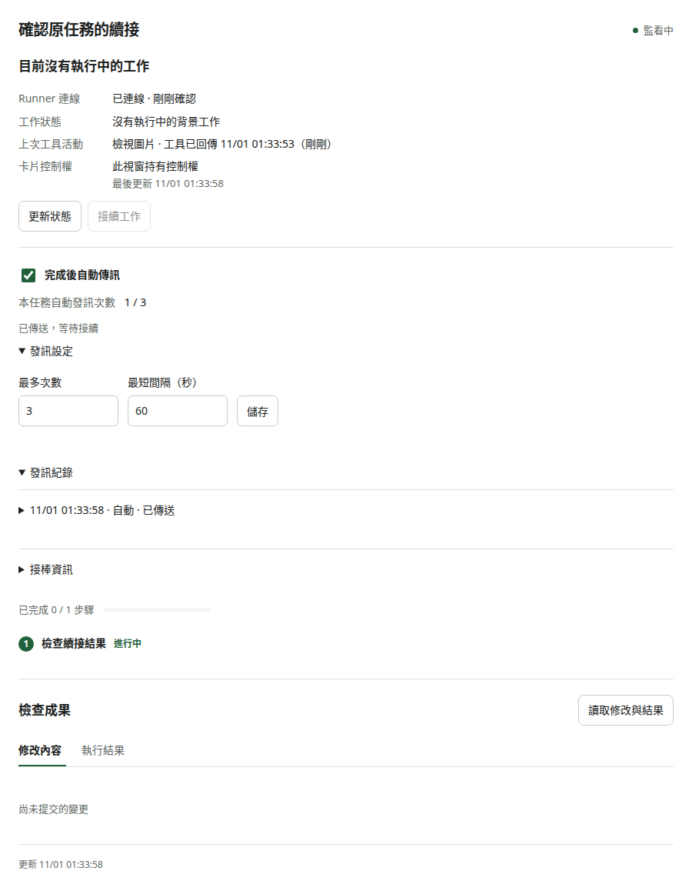
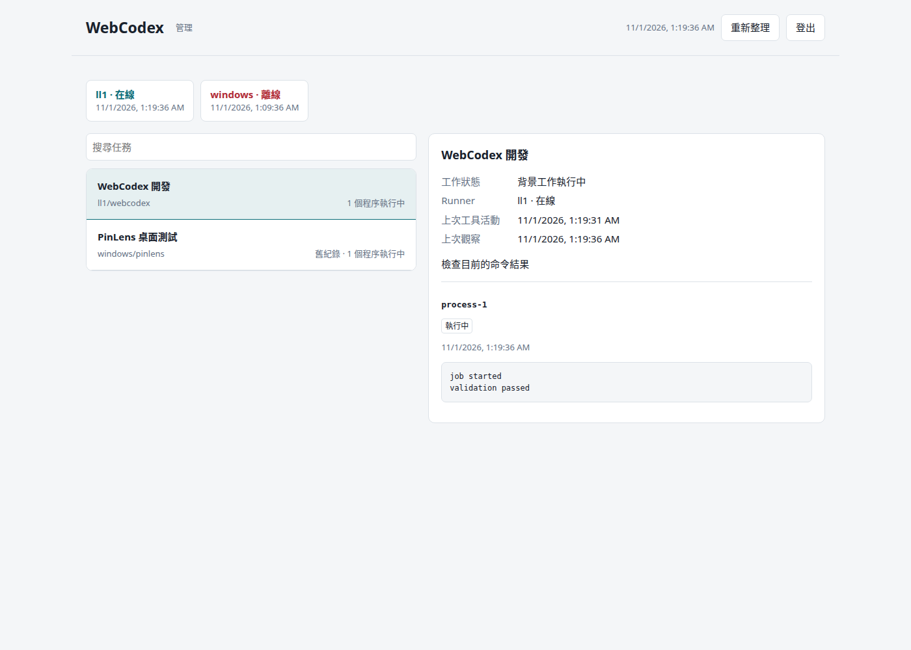

# 完整操作：命令執行、查看結果、跨對話接手



操作示範（測試資料）。



操作示範（測試資料）。

假設在自己的 repo 修正測試失敗，向 ChatGPT 提供目錄與需求：

> 檢查這個 repo 的測試失敗，修正後再跑一次。命令還在執行時，留在本回合取得結果。完成後保存修改檔案、驗證結果與下一步。

WebCodex 依序處理：

1. `projects_list` 選擇已授權專案，`work_on_project` 建立任務並取得 Git 狀態。
2. `exec_command` 執行測試，回傳持久的 job ID 與 process ID。
3. 測試期間先讀取相關檔案；等待時用 `job_get`／`read_process`，沿用原程序。
4. 檢查失敗輸出、修改、重跑必要測試，以 `task_review` 查看 diff 與結束碼。
5. `task_update` 保存結果，卡片顯示工作狀態。自動發訊維持關閉。

## 在本機執行同一流程

Server 與 Runner 啟動後，在同一安裝環境執行：

```text
uv run python examples/same_turn_demo.py --project local/project
```

這段示範實際呼叫 Server 與 Runner，建立四秒命令並在同一程序中讀回結果。它會輸出 `task_id`、`process_id`、兩行命令結果及 `exit_code`；打開 `/manage` 可找到同一個任務。

```text
demo started
demo finished
exit_code: 0
```

程式完成後，在 ChatGPT 使用 `task_get` 讀取輸出的 task ID，即可查到同一份結果。需繼續修改時，用 `task_update` 重新開啟任務。

## 換對話接手

新對話選擇同一 WebCodex 連線，請求接續指定 task ID。模型呼叫 `task_takeover`，讀取目標、已改檔案、驗證結果、未讀輸出及下一步，再從原 job／process 接續。原卡片失去發訊控制權；「完成後自動傳訊」保持關閉。

需要後續訊息時，在卡片明確開啟「完成後自動傳訊」，設定本任務次數與間隔。隨時可改用「接續工作」手動接回。
